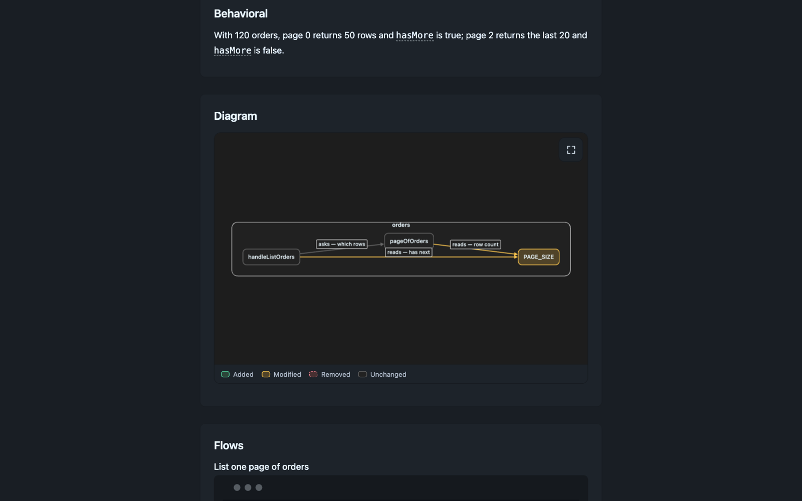
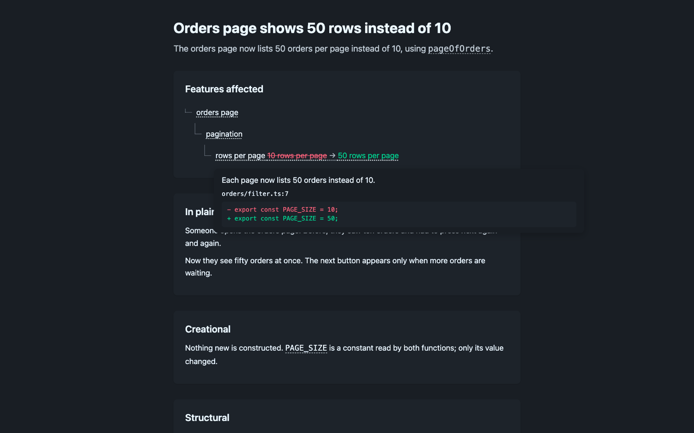
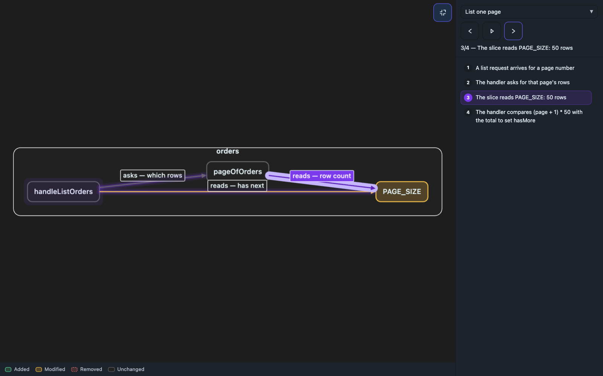

# ns-explain

Explain a code change in plain language, then export one HTML file with an
interactive diagram. This repository is both the user-level skill and the
`ns-explain` package.

The skill (`SKILL.md`) tells an agent how to read a commit, branch, or diff and
answer through three lenses (creational, structural, behavioral). When the user
also asks for a file, the agent writes a JSON manifest and this CLI renders it
into a fixed HTML template. The agent never writes the HTML itself.

## Install the skill

```bash
synca skills install https://github.com/ngosangns/ns-explain
```

That copies the skill to `~/.agents/skills/ns-explain` and links it into each
agent.

Requirements:

- Node 22.18 or newer. It runs the TypeScript directly, no build step.
- `bun` on `PATH` for `render`. It bundles the diagram viewer into the page.
- Internet access when you open an export. The page loads Tailwind, DaisyUI,
  highlight.js, Cytoscape, and dagre from `cdn.jsdelivr.net`.

## Commands

The repository root is the package; its `bin` is `scripts/ns-explain.ts`. From a
checkout:

```bash
node scripts/ns-explain.ts playbook
node scripts/ns-explain.ts render .ns-explain/<name>.json
node scripts/ns-explain.ts serve .ns-explain/<name>.html
```

| Command | What it does |
| --- | --- |
| `help` (or no command) | Prints the command and manifest-field index. An unknown command prints the same index and exits with code 2. |
| `playbook` | Prints `artifact-playbook.md`: manifest schema, the `.ref` component contract, the diagram DSL, and authoring rules. Read it before writing a manifest. |
| `render <manifest.json>` | Validates the manifest, bundles the viewer with `bun build`, and writes one self-contained HTML file. |
| `serve <file.html> [--port <n>] [--no-open]` | Serves the file's directory over HTTP and opens the browser. |

### render

- Output: `.ns-explain/<name>.html`, under the **current working directory**.
  `<name>` is the manifest's `name`, or the manifest filename without its
  extension, lowercased and reduced to `a-z0-9` and `-`.
- Every file referenced by a `data-path` in the prose fragments, a graph node or
  edge `path`, or the `files` list is read relative to the working directory
  and embedded in the page, so "View file" works offline from the file. Files
  that cannot be read are reported as `missing file` on stderr.
- stdout is one JSON line: `{"html": "...", "filesEmbedded": N, "serve": "..."}`.
- Problems are printed to stderr as `warning:` lines (dangling graph ids,
  `.ref` spans without `data-desc`, bare `<code>` identifiers, identifiers in
  features-only fields, concepts that never appear in the prose). The file is
  still written; fix the warnings and render again.
- A missing `title`, `oneLiner`, or `graph` exits with code 2.

### serve

- Binds to `127.0.0.1` only. The port is random unless you pass `--port`.
- The web root is the HTML file's directory; paths outside it return 403.
- Prints `serving <dir>` and the URL. Responses send `cache-control: no-store`,
  so a re-render shows up on reload.
- Opens the URL with `open` (macOS), `xdg-open` (Linux), or `start` (Windows)
  unless `--no-open` is set. Runs until you stop it (Ctrl-C or SIGTERM).
- There is no authentication; it is a local preview server.

## Manifest

`render` takes a JSON file, conventionally `.ns-explain/<name>.json`. Fields
marked `*` are required.

| Field | Meaning |
| --- | --- |
| `name` | Output file name. Defaults to the manifest filename stem. |
| `lang` | `"vi"` (default) or `"en"`. Sets section labels and the diagram legend. |
| `title`* | Document title. |
| `oneLiner`* | One-sentence summary. HTML fragment; may contain `.ref` spans. |
| `featureTree` | Nested `[{label, children, changes}]`. Each `changes` entry is `{kind: "added" \| "modified" \| "removed", text \| old + new, hunks: [{path, line, diff, explain}]}`. Features only, no identifiers. |
| `plainTerms` | HTML paragraphs in plain language. Features only. |
| `lenses` | `{creational, structural, behavioral}` HTML fragments. Components are named with `<span class="ref" data-path data-line data-desc>`. |
| `pseudocode` | `[{title, code}]`, one per flow. `code` is plain text. |
| `concepts` | `[{term, explain}]`. `render` wraps each term in the prose with a click popover. |
| `graph`* | The diagram, see below. |
| `theme` | `"system"` (default, follows the OS) or a DaisyUI theme name. |
| `extraHead` | Raw HTML appended to `<head>`, for project fonts or tokens. |
| `files` | Extra repo-relative paths to embed besides the auto-detected ones. |
| `testResults` | Optional, adds a last "Test results" section. Shape: `{command, environment?, scope: "full" \| "package" \| "related", scopeNote, passed, total, skipped?, failed: [{name, message}], earlier?: [{label, passed, total, failed, cause?}], files: [{path, line?, desc?, tests: [{kind: "added" \| "modified", name, line?, behavior}]}]}`. Use `{notRun: "reason", files}` when nothing was run. Counts must come from a run that really happened. `render` warns on `passed > total`, failures with all-pass counts, a test with no `behavior`, and an unreadable spec path. |

The diagram is a single graph; types are in `scripts/src/types.ts`:

- `nodes`: `{id, label, kind?, parent?, change?, desc?, path?, line?}`. `parent`
  groups nodes into a package container.
- `edges`: `{id, source, target, label?, decides?, path?, line?, change?}`.
- `flows`: `{id, title, steps: [{target, note}]}`. `target` is a node or edge
  id; steps replay as a highlight in the full-screen view.
- `change` is `added`, `modified`, `removed`, or `same` and sets the colour.
- `labels` overrides legend text.

The full contract lives in `artifact-playbook.md` (`ns-explain.ts playbook`).

## Example

`docs/examples/page-size/` holds a small manifest and the two source files it
points at. Render it from that directory, because paths in the manifest are
relative to the working directory:

```bash
cd docs/examples/page-size
node ../../../scripts/ns-explain.ts render page-size.json
node ../../../scripts/ns-explain.ts serve .ns-explain/page-size.html
```

This writes `docs/examples/page-size/.ns-explain/page-size.html`, which is not
ignored by `.gitignore`; delete it when you are done.

## Screenshots

Rendered from the example above in Chrome at 1440 px wide.



The exported page, scrolled to the end of the lenses, the interactive diagram
(changed nodes and edges are coloured; the legend is below it), and the Flows
section. The page above these also holds the feature tree and plain-terms text.



Clicking a feature opens a popover with the diff that implements it and a
plain sentence about what that diff does.



The full-screen diagram. The side panel picks a flow and steps through it; the
current hop is highlighted on the graph.

## Review comments

Every exported page carries a comment layer, so feedback does not need a second
tool:

- Hover a paragraph, list item, heading, feature row, pseudocode block or the
  diagram: a comment icon appears to its right. On a touch screen, tap the block.
- The same works inside the boxes the page opens: a hunk in a feature's diff
  popover, the popover behind a dotted or dashed underline or a diagram element,
  and a line (or a selected span of lines) in the "View file" dialog. The icon
  sits in the top-right corner of that box.
- Select any text: a comment icon appears next to the selection. The selected
  text is quoted in the comment.
- The icon opens a small box. `Ctrl+Enter` (or `Cmd+Enter`) saves, `Escape`
  cancels. Reopen a commented place to edit or delete its comments.
- A commented block gets a bar on its left edge. The row or underlined word that
  opens a commented popover gets a dot, so you can see where comments are
  without opening anything.
- Comments live in memory only. Reloading the page drops them.
- The `Comments (n)` button, bottom right, opens the list in document order. Each
  entry shows its place, an excerpt, and the note, with `Jump to`, `Edit` and
  `Delete`. `Jump to` scrolls to the block, or reopens the popover or file that
  held the comment and flashes it. `Clear all` asks for a second click.
- The `Copy comments` button, next to it, copies all comments as plain text.
  Each entry has the section, the position inside it (paragraph number, feature
  path, popover, or file and line), an excerpt, the selected text, the files the
  block refers to, and the comment. Paste it into the agent, which edits the
  manifest and renders again.

Button and dialog text follow the manifest `lang` (`vi` or `en`). The buttons
move into an open dialog or popover, because those sit above the page.

## Layout

```
SKILL.md               skill instructions for the agent
artifact-playbook.md   manifest and diagram contract (printed by `playbook`)
scripts/ns-explain.ts  CLI: playbook, render, serve
scripts/serve.ts       local HTTP server used by `serve`
scripts/render.test.ts tests for `render` (run with `bun test`)
scripts/template.html  fixed HTML shell filled in by `render`
scripts/src/           TypeScript viewer and page runtime, bundled by bun
docs/                  example manifest and screenshots
```
